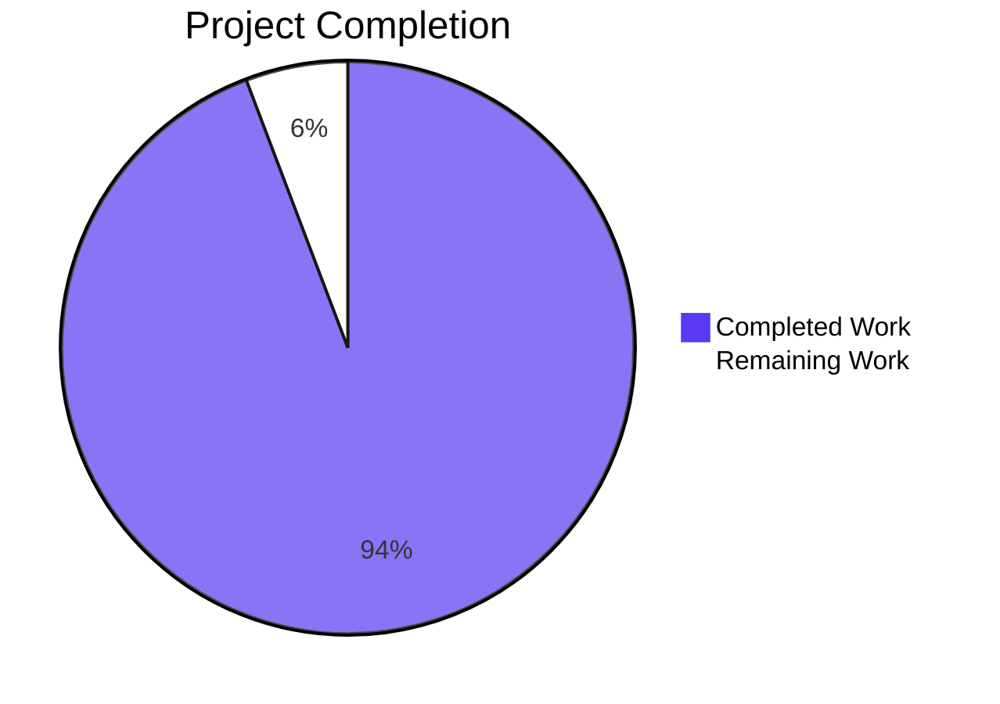
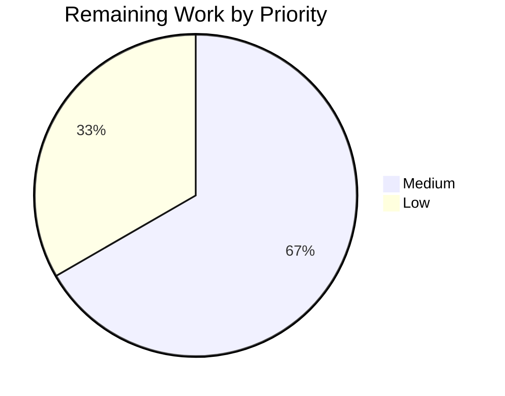

# 1. Executive Summary

## 1.1 Project Overview

A deliberately minimal Node.js command-line program whose whole job is to print one unformatted line, `Welcome to Blitzy`, in the fewest lines and characters possible. The deliverable is the entire repository: `index.js`, a two-line CommonJS script carrying a one-line JSDoc summary and a single `console.log`, and a four-line `README.md` stating what the program prints and how to run it. Its users are the requester and any developer who clones the repository and runs one command; there is no other persona and no input. Its value is a byte-exact, dependency-free program that costs nothing to install, operate or maintain.

## 1.2 Completion Status

Everything the Agent Action Plan scoped is delivered and verified: both files sit at the repository root with exactly the specified contents, the program prints exactly the specified line, and no excluded artefact exists in the tree.

**94.2 % complete — 24.5 of 26.0 scoped hours delivered**



Completed work is drawn in Blitzy dark blue (#5B39F3) and remaining work in white (#FFFFFF).

| Metric | Hours |
|--------|-------|
| Total Hours | 26.0 |
| Completed Hours (AI + Manual) | 24.5 |
| Remaining Hours | 1.5 |

Completion = 24.5 ÷ 26.0 = **94.2 %**.

## 1.3 Key Accomplishments

- Prints exactly `Welcome to Blitzy`: 18 bytes with one trailing newline, no colour, prefix or second line.
- Runs directly with nothing installed — no manifest, lockfile, dependency, build or install step.
- Consumes no input: every argument, standard-input and environment variant leaves the output byte-identical.
- Deterministic and side-effect free: repeated and concurrent runs print one line and leave the tree unchanged.
- Two files only, with no placeholder marker and no test, build, CI, container or configuration artefact.
- Each claim in the four-line README resolves to the source, including the run command that produces the printed text.

## 1.4 Critical Unresolved Issues

**2 of the 13 scoped requirements carry an accepted caveat, and neither blocks release.**

| Issue | Impact | Owner | ETA |
|-------|--------|-------|-----|
| No automated guard re-checks the byte-exact acceptance criterion, because a test suite, linter and CI are excluded by the request | A later edit to the literal, the quoting or the README's claims would break acceptance silently | Maintainer | Before the next change ships |
| The program has never been run on a Node.js major release other than v22.23.3 | Version independence rests on the source containing no version-specific API rather than on an observed second-major run | Deployment-target maintainer | At the next runtime change |

## 1.5 Access Issues

No access issues identified. No credential, service, dependency registry or third-party API is involved: the runtime is installed, the program reads no secret, and it opens no file, socket or process.

## 1.6 Recommended Next Steps

1. **[Medium]** Run the program on a second Node.js major release and confirm the same 18-byte line (1.0 h).
2. **[Medium]** Record the release acceptance check for the fixed file contents, since nothing automated guards them (0.5 h).
3. **[Low]** Name the working directory in usage instructions published outside the README; the documented command is repository-root-relative.
4. **[Low]** Re-run the two-command gate on the target runtime at every Node.js upgrade.

# 2. Project Hours Breakdown

## 2.1 Completed Work Detail

Every component below traces to a named requirement of the Agent Action Plan: the functional requirements F1–F7, the non-functional requirements N1–N6, and the plan's own delivery obligations.

| Component | Hours | Description |
|-----------|-------|-------------|
| Welcome printer and run path (`index.js`) — F1, F2, F3, F4, F7 | 5.0 | The two-line program that prints the exact unformatted line with one trailing newline, takes no input and needs no build or install step, verified at the byte level for standard output, standard error and exit status. |
| Single-line JSDoc summary — F5 | 0.5 | The one `/** ... */` sentence documenting the file, verified free of tags and placed immediately before the statement. |
| Documentation and its accuracy (`README.md`) — F6 | 2.0 | The four-line README and the resolution of each of its claims — the printed text and the run command — against the code's literal and path. |
| Two-file footprint and absence of a maintenance surface — N1, N2, N6 | 3.0 | Establishing and verifying that the tree holds only the two delivered files, with no manifest, lockfile, dependency, test suite, build or CI anywhere, and measuring the line and byte counts. |
| No-input, no-configuration, no-hardening design — N3, N4 | 3.0 | Verification that no argument, standard input, environment variable or configuration file is read, and that the single write has no failure path or error handling. |
| Portability determination — N5 | 1.0 | Confirming the sole API used is the runtime's long-standing global `console`, with no version-specific or deprecated construct and no engine pin. |
| Requirements, directive and rules compliance evidence | 4.0 | The compliance record over the whole deliverable: the functional and non-functional verdicts, the directive matrix and the security baseline over a two-file tree. |
| Runtime acceptance validation | 6.0 | Execution across the invocation, argument, standard-input, environment, transport, sink, repeatability and concurrency matrices, with every captured stream compared byte-for-byte. |
| **Total** | **24.5** | Matches the Completed Hours value in Section 1.2. |

## 2.2 Remaining Work Detail

| Category | Hours | Priority |
|----------|-------|----------|
| Cross-release portability verification on a second Node.js major release (requirement N5) | 1.0 | Medium |
| Release acceptance check for the fixed file contents, and recording that the documented command is repository-root-relative (path to production) | 0.5 | Low |
| **Total** | **1.5** | |

Completed 24.5 h + remaining 1.5 h = 26.0 h total. Completion = 24.5 ÷ 26.0 = **94.2 %**. Neither remaining item changes the delivered artefact: the first deepens verification of a property the source already satisfies, and the second writes down the gate that replaces the automated checks this project may not carry.

# 3. Test Results

This repository carries no test suite, test runner or coverage tooling, and adding one is excluded by the request: acceptance rests on the two files' contents. The verification below is therefore the repository's own gate — `node --check index.js && node index.js` — plus the behavioural checks executed against the delivered files in this assessment. Every count is one that was executed and observed: **52 checks, 52 passed, 0 failed, across 46 program invocations.**

| Area / Category | Framework | Tests | Passed | Failed | Coverage | What This Proves |
|-----------------|-----------|-------|--------|--------|----------|------------------|
| Syntax and parse gate | `node --check` (Node.js CLI) | 1 | 1 | 0 | Not measured — no coverage tooling exists or may be added | The delivered source parses cleanly under Node.js v22.23.3 with no build step. |
| Output bytes and streams | Node.js CLI with `od`, `cmp`, `wc` | 9 | 9 | 0 | Not measured | The program prints the exact 18-byte line with one trailing newline, empty standard error and exit status 0, free of colour, carriage returns and byte-order marks. |
| Invocation and input surface | Node.js CLI | 12 | 12 | 0 | Not measured | No argument or standard input is consumed: the output is identical however the process is invoked, with no usage text, prompt or error. |
| Environment independence | Node.js CLI | 8 | 8 | 0 | Not measured | No environment variable or configuration file is read, and colour forcing adds no escape byte. |
| Transports and output sinks | Node.js CLI with `cmp` | 3 | 3 | 0 | Not measured | The same bytes reach a file, a pipe and a discarded stream, with no diagnostic when the stream is discarded. |
| Determinism, concurrency and tree immutability | Node.js CLI with `sha256sum`, `cmp` | 4 | 4 | 0 | Not measured | Repeated and concurrent runs are byte-identical and write nothing to the working tree. |
| Repository footprint and maintenance surface | `find`, `git ls-files`, `grep` | 8 | 8 | 0 | Not measured | The tree holds exactly two files, with no manifest, lockfile, dependency, test, build, CI or container artefact and no TODO or placeholder marker. |
| Documentation claims and working-directory independence | Node.js CLI with `cmp`, `grep` | 7 | 7 | 0 | Not measured | Every README claim resolves to the code, and the run command produces the documented text when addressed by an absolute path from any working directory. |

**Not Covered**

- **Nothing automated runs on its own.** No test suite, runner or coverage tool is configured, and adding one is excluded by the request; the gate above plus these checks are the entire verification surface. A human should re-run them after any edit.
- **Cross-release portability.** The program has never been executed on a Node.js major release other than v22.23.3, the only one present on this host. Before release, run `node --check index.js && node index.js` on the target release and compare the output byte-for-byte.
- **An unwritable standard output.** This was observed once, and it reflects the sink rather than the program: redirecting to a full device exits 0 with empty standard error because no write check exists. Where a consumer depends on delivery, verify the received bytes, not the exit status.
- **Any screen, route, database, queue or third-party call.** None exists in this project, so none was available to test.
- **A change that preserves the output.** The acceptance criterion is the file contents themselves, so an edit that leaves the printed line identical — an added comment, for instance — still breaks acceptance. Compare both files against the fixed contents byte-for-byte, not only the output.

# 4. Runtime Validation & UI Verification

- ✅ **Start-up and printed line** — `node index.js` from the repository root: exit status 0, standard output exactly 18 bytes (`Welcome to Blitzy` plus one newline), standard error empty.
- ✅ **No-install run** — the program runs with nothing installed: no manifest, lockfile, dependency or `node_modules` in the checkout or in any ancestor directory, and no build or transpile step.
- ✅ **Stripped environment** — identical output under an empty environment, with `PATH` emptied and `HOME` pointing at a non-existent path; injected secret-shaped variables change nothing.
- ✅ **Argument surface** — `--help`, `-h`, `--version`, `-v`, positional arguments, an empty-string argument and a shell-metacharacter argument are all ignored; no usage text, banner or error is produced.
- ✅ **Standard input** — `/dev/null`, a regular file, a pipe and a closed descriptor are never read: no prompt, no hang, unchanged output.
- ✅ **Output transports** — the same bytes whether standard output is a file, a pipe, a terminal or merged with standard error.
- ⚠ **Unwritable output sink** — redirecting to a full device exits 0 with an empty standard error, because no write check exists by design; treat a redirect's exit status as no proof that the line was delivered.
- ✅ **Determinism and concurrency** — five sequential and ten concurrent runs produced one identical line, and the working tree was unchanged after every run.
- ✅ **Documentation seam** — the command in `README.md:4`, executed from the repository root, prints exactly the text `README.md:3` states.
- ⚠ **Not exercised / not applicable** — the program has never run on a Node.js major other than v22.23.3, the only one present here; there is no user interface, HTTP endpoint, database, queue or external integration in this project, so no screen, route or third-party call was available to drive.

# 5. Compliance & Quality Review

## 5.1 Compliance Matrix

| Deliverable (traceability) | Benchmark Applied | Status | Evidence |
|----------------------------|-------------------|--------|----------|
| Exact unformatted output — F1, F2 | Output fidelity and byte-level correctness | ✅ Pass | Standard output is byte-identical to the required line with its single newline; zero escape, carriage-return, byte-order-mark, leading-space or quote bytes; one line, one newline (`index.js:2`). |
| Direct execution with no build or install — F3, and the run instruction | Reproducible execution from a clean checkout | ✅ Pass | `node index.js` exits 0 with nothing installed; no manifest, lockfile or `node_modules` in the checkout or any ancestor. |
| No input surface — F4 | Input validation and surface minimisation | ✅ Pass | Twelve argument and standard-input checks and eight environment checks all leave the output byte-identical; no input is read anywhere in the source. |
| Single-line JSDoc surface — F5 | Documentation of the code's public surface | ✅ Pass | `index.js:1` is one `/** ... */` sentence, free of tags, immediately before the statement it documents; nothing is exported, so that line is the whole documented surface. |
| README documentation — F6 | Documentation accuracy and honesty of claims | ✅ Pass | Four lines stating the printed text and the run command; executing the documented command from the repository root reproduces the documented text exactly. |
| Byte-exact acceptance criterion — F7 | Release acceptance against a fixed specification | ✅ Pass | Both files are byte-identical to the specified contents — `index.js` 79 bytes, `README.md` 82 bytes — and match their committed blobs; the output matches the specified literal. |
| Minimum size — N1 | Lean implementation | ✅ Pass | Measured 2 lines / 79 bytes and 4 lines / 82 bytes, exactly the specified sizes, with no blank line, second comment or trailing whitespace. |
| Zero dependencies and no maintenance surface — N2, N6 | Dependency and maintenance hygiene | ✅ Pass | No manifest, lockfile, dependency, test suite, build, CI or container artefact exists anywhere in the tree; the only external symbol is the runtime's global `console`. |
| No configuration, secrets or environment variables — N3 | Secret handling and configuration hygiene | ✅ Pass | No configuration file or `.env` exists; the output is unchanged under a stripped environment and with secret-shaped variables injected; no credential appears in either file. |
| No error handling or unrequested hardening — N4, and the quality standards | Defensive-coding proportionality | ✅ Pass | One unguarded statement with no branch, handler, listener or logger; exit 0 with empty standard error across every invocation family. |
| Portability across Node.js releases — N5 | Runtime portability | ✅ Pass | The sole API is the long-standing global `console`, with no version-specific construct and no engine pin; execution on a second major remains unexercised and is carried as remaining work. |
| Scope boundary and directive compliance | Scope discipline and change minimality | ✅ Pass | Two commits, two paths, six lines added and two removed; every excluded artefact is absent, and no code outside the two delivered files changed in any commit or reference. |

## 5.2 AAP & Rule Divergences and Gaps

Seven divergences were established. None needs a repository change, and none blocks release.

| What the AAP / Rule Required | What Was Delivered Instead | Why It Diverged | Impact | Remediation |
|------------------------------|----------------------------|-----------------|--------|-------------|
| Run a linter or formatter in check mode on each modified file, and run the test suite covering them | Neither was run; `node --check index.js` served as the syntax gate | A linter, formatter, test runner or manifest cannot exist here: the request forbids adding any file, dependency or tooling, and the plan's own quality standards add no test suite | None — the applicable gate passes and the delivered files are byte-exact | None; sanctioned by the request and the plan |
| Validate source files at the source-code validation level | `README.md` was validated as documentation | That rule scopes its minimum to source code, and a documentation file has no compile, test or dependency surface | None | None |
| Both mapped files are new; "nothing is updated, deleted or left in a modified state" | `README.md` was rewritten in place at the same path | The file already existed in the repository as a two-line stub, so the delivered contents replaced it in place | None to the contents — byte-identical to the specification, with no duplicate, no rename and no third file; the plan's pre-state description is stale for that row | No code change exists; correct the plan record if it is reused |
| The working directory held no source file and no `.git` directory | The repository's history begins at an initial commit that already carried a `README.md` stub | The plan's plan-time picture of an empty directory did not match the workspace it was written against | None to the code; the create/update dispositions in the plan cannot be taken at face value | None in code |
| A single-line JSDoc summary documenting the file | A one-line JSDoc summary sits above a bare statement, not above a declaration | The directive fixes the exact text and placement, and the size requirement fixes the file at two lines with nothing to declare | Documentation tooling that requires a declaration would attach it to nothing; deliberate and mandated | None — any change would breach the acceptance criterion |
| Acceptance rests on the exact file contents | Acceptance does rest on them, but nothing re-checks them automatically | A test suite, linter and CI are excluded by the request, so no automated guard may be added | A later edit to the literal, the quoting or the README's claims would break acceptance silently | Record the release acceptance check counted in Section 2.2 |
| The documented run command is `node index.js` from the repository root | Delivered exactly so; the four-line README does not state the working directory | The README's four lines and the invocation form are both fixed by the specification | A reader who copies the command from a subdirectory meets an ordinary module-resolution error | None inside the four fixed lines; state the working directory in usage instructions published elsewhere |

**The linter and test-suite steps were departed from (sanctioned).** The generic engineering steps assume tooling this project may not carry. The request forbids any additional file, dependency, manifest or test artefact, and the plan adds no test suite or coverage target, so a linter and a runner cannot be configured here without undoing the specification. What stands in their place is the repository's own gate, `node --check index.js && node index.js`, which passes: the source parses without a diagnostic and the program prints the required line with an empty standard error. Syntax and behaviour are guarded by that gate alone, and adding tooling later would violate the file list this project was accepted against.

**Validation level for the documentation file (sanctioned).** The validation-level rule sets a minimum for source code; `README.md` is documentation with no compile surface, no dependents and no test surface, so it was validated as documentation. The substantive check the higher level exists to provide was still performed: every claim in the file was resolved against the code, including the run command, which was executed from the repository root and produced exactly the text the file claims. The decision changes nothing a reader relies on. If the project later gains source files with a compile or test surface, apply the source-code minimum to those files and leave the README as it stands.

**`README.md` recorded as new but delivered as an update.** The plan records both files as created against an empty working directory and states that nothing was updated. In the repository the file already existed: the initial commit carries a two-line stub, and the delivered version replaced those two lines in place at the same path. The outcome is exactly what was specified — the four lines are byte-identical to the required contents, no placeholder line survives, there is no second README and no rename — so the divergence is in the plan's account of its starting point, not in the artefact. A reader reusing that plan record should treat its file dispositions as intent rather than as measured state.

**The plan's picture of the starting workspace was inaccurate.** The plan states that the working directory held no source file and no `.git` directory when it was written; the repository's own history shows an initial commit that already contained a `README.md` stub. Nothing delivered is affected — the two files match the specification byte for byte, nothing outside them was touched, and no third file exists — but the plan's create/update dispositions cannot be taken at face value, which is the same root cause as the divergence above. No code change can settle it. If the plan record is reused for a later change, start from the repository's actual state rather than from that description.

**The mandated JSDoc summary annotates a statement, not a declaration (sanctioned).** The one-line summary sits above `console.log("Welcome to Blitzy");`, a bare statement. Documentation tooling and JSDoc-aware linters expect a declaration, so they would attach the comment to nothing. This is precisely the form the request and the plan mandate: one `/** ... */` sentence, no tags, immediately before the statement it documents, in a file held to two lines so that no declaration could be introduced. A reviewer should not read it as an oversight, and no change may be made — any edit to that line breaks the byte-exact acceptance criterion. The rationale it carries is accurate: the file does print that exact line to standard output.

**Acceptance is byte-exact but unguarded by design.** The delivered files are byte-identical to the specified contents, and the program's output is byte-identical to the specified line; that is the acceptance criterion, and it is currently met. Nothing re-checks it automatically, because a test suite, linter and CI are excluded by the request, and this is the project's largest residual risk: a future edit to the literal `Welcome to Blitzy`, a changed quote style, or a reworded README would break acceptance with no signal. The remedy is procedural rather than automatic — the release acceptance check counted in Section 2.2, which compares both files against the fixed contents and compares the program's output byte-for-byte.

**The documented command is repository-root-relative.** `README.md:4` gives `node index.js`, which is correct from the repository root and fails from any other directory with an ordinary module-resolution error; the four lines are fixed by the specification and do not say so. The supported alternatives were checked and work: run it from the repository root, or invoke the file by an absolute path from anywhere. Nothing in the repository should be changed for this. What a reader should take away is a documentation habit — any usage instructions published outside those four fixed lines should name the working directory, so a newcomer does not meet the error first.

# 6. Risk Assessment

Risks below are forward-looking: what could still go wrong once this code is in use.

| Risk | Category | Severity | Probability | Mitigation | Status |
|------|----------|----------|-------------|------------|--------|
| A later edit to `index.js:2` or to the README's claims breaks the byte-exact acceptance criterion, and nothing automated would report it | Technical | Medium | Medium | Perform the release acceptance check before shipping a change: compare both files against the fixed contents and the program's output byte-for-byte | Open, accepted by design — a test suite, linter and CI are excluded by the request |
| The product's entire behaviour rests on a single line of source | Technical | Medium | Low | Treat any edit to the literal as release-affecting, and re-run the two-command gate afterwards | Open, inherent to the two-line deliverable |
| Behaviour on Node.js releases other than v22.23.3 remains unverified | Technical | Low | Low | Run `node --check index.js && node index.js` on the target release at upgrade time and compare the output byte-for-byte (1.0 h in Section 2.2) | Open |
| An unwritable standard output reports success silently: exit 0 with an empty standard error | Operational | Low | Medium | Do not treat a redirect's exit status as proof of delivery; verify the received bytes wherever a consumer depends on them | Open, accepted by design — no write check exists |
| The documented run command is repository-root-relative | Operational | Low | Medium | State the working directory in usage instructions published outside the README, and invoke the file by absolute path from elsewhere | Open — addressed by the release check in Section 2.2 |
| The project's rules set is empty, so no project-specific standard governs future changes | Operational | Low | Low | Apply enterprise best practice; if a rules document is introduced, re-derive compliance from it before the next change | Open, accepted |
| The README's heading wording differs in word order from the printed greeting, which a reader may read as an inconsistency | Operational | Low | Low | None required — both strings are the fixed acceptance criterion and neither may change | Accepted |
| Security exposure could only come from the platform the program runs on, never from its code | Security | Low | Low | Keep the runtime on a supported release; the program reads no input, holds no secret, and opens no file, socket or process | Accepted |

**Integration: no risk applies.** The program declares no dependency, opens no network connection and exchanges no data with any external system; its only interface is its own standard output. The delivered tree contains no client, route, queue, webhook or configuration, and no listening socket exists in the environment, so there is no integration surface for a failure to originate in. The absence is the specification, not an omission.

# 7. Visual Project Status


Completed work is drawn in Blitzy dark blue (#5B39F3) and remaining work in white (#FFFFFF). The two values are the same ones reported in Section 1.2 and summed in Sections 2.1 and 2.2.



No High-priority work remains: nothing is incomplete, and nothing in the delivered project blocks compilation, start-up or the program's behaviour.

| Remaining item | Priority | Hours |
|----------------|----------|-------|
| Cross-release portability verification on a second Node.js major release | Medium | 1.0 |
| Release acceptance check for the fixed file contents | Low | 0.5 |
| **Total** | | **1.5** |

# 8. Summary & Recommendations

This project delivers a two-line Node.js program at `index.js` that prints exactly `Welcome to Blitzy` with one trailing newline, and a four-line `README.md` that states the printed text and the command that produces it. Both files are byte-identical to the fixed specification — 79 and 82 bytes — and the program exits 0 with an empty standard error under every condition exercised: 52 checks spanning the syntax gate, output bytes, arguments, standard input, environment, transports, output sinks, repeat runs and concurrency. The tree holds nothing else: no dependency, manifest, lockfile, build step, test artefact, configuration file or container definition. **94.2 % of the scoped hours are complete — 24.5 of 26.0.**

| Metric | Value |
|--------|-------|
| Scoped hours completed | 24.5 of 26.0 (94.2 %) |
| Verification checks executed | 52 passed, 0 failed, over 46 program invocations |
| Delivered files | 2 (`index.js`, `README.md`), both byte-exact to the specification |
| Scoped requirements with an accepted caveat | 2 of 13; none blocks release |

What remains is verification and governance rather than construction, and it is 1.5 hours of work. First, run the program on a second Node.js major release and confirm the same 18-byte line: version independence currently rests on the source containing no version-specific API, not on an observed second-major run, because only v22.23.3 is present here. Second, record the release acceptance check for the fixed file contents, which compares both files against the specification and the program's output byte-for-byte — necessary because no test suite, linter or CI may exist to guard a byte-exact criterion. Neither item blocks using the program today: with a supported Node.js release present, there is nothing to install, configure or operate.

Production readiness, judged by what this deliverable is, is **ready**. It is a deliberately minimal demonstration program whose acceptance criterion is the exact file contents; by that standard the tree is complete, faithful to the specification, parse-clean and needs nothing further. It would not satisfy a general-purpose standard — there are no tests, no CI, no logging, no error handling and no version pinning — but each of those absences is an explicit instruction of the request, so none is a gap in this deliverable.

Success is already measurable: the program prints the required line, both files match the specification byte for byte, the tree carries no artefact the specification excludes, and the documented command resolves to the real entry point from the repository root. The one thing to watch is the criterion's silence: nothing re-checks it automatically, so treat any edit to the literal on `index.js:2`, the quoting, or a claim in the README as release-affecting, and run the recorded acceptance check before shipping.

The recommendation is to keep the footprint exactly as it is. Adding tests, a manifest, a linter, a lockfile or CI would each violate the file list this project was accepted against, and none of them is needed to run or operate it. If the project later grows past this scope — a second source file, an argument surface, or a distribution step — that is the moment to add the guard rails, and at that point the byte-exact criterion will have to be replaced by something the tooling can express.

# 9. Development Guide

**System prerequisites**

- Node.js 22.x or newer, on `PATH`. The runtime verified for this project is v22.23.3: `node --version` reports it and `command -v node` resolves it.
- Nothing else. No database, service, port, container, hardware requirement or network access is involved at run time, and no credential is needed.
- The program uses no version-specific API, so any supported Node.js release runs it unchanged.

**Environment setup**

- There is nothing to configure. The repository contains no environment file, no settings file and no configuration of any kind, and the program reads no environment variable — running it under an empty environment produces identical output.
- Work from the repository root, the directory that holds `index.js` and `README.md`.

**Dependency installation**

- Nothing to install. The repository declares no dependency, carries no manifest or lockfile, and has no `node_modules` in the checkout or in any ancestor directory. The program uses only the runtime's built-in `console`.
- Do not add a `package.json`, a lockfile or a package: the acceptance criterion is the exact file list, and creating any of them breaks it.

**Start-up sequence**

```bash
# 1. open a shell at the repository root
cd <repository root>

# 2. run the program
node index.js
```

Expected output — one line, then the shell prompt:

```
Welcome to Blitzy
```

**Verification steps**

```bash
# 1. the source parses cleanly: silent, exit status 0
node --check index.js

# 2. the exact bytes on standard output
node index.js | od -c
# 0000000   W   e   l   c   o   m   e       t   o       B   l   i   t   z
# 0000020   y  \n
# 0000022

# 3. one line, one trailing newline: 18 bytes, 1 line
node index.js | wc -c    # 18
node index.js | wc -l    # 1

# 4. nothing on standard error
node index.js 2>&1 | cat # prints only: Welcome to Blitzy

# 5. running the program writes nothing
git status --porcelain   # no output
```

For the release acceptance check, compare both files against the contents the specification fixes — byte-for-byte, not by eye — and compare the program's output byte-for-byte with the required line. A change that leaves the output identical, such as an added comment, still breaks acceptance, because the criterion is the file contents themselves.

**Example usage**

The whole interface is one command and one line of output; nothing changes it:

```bash
node index.js                  # Welcome to Blitzy
node index.js --help           # Welcome to Blitzy
node index.js somearg          # Welcome to Blitzy
echo "ignored" | node index.js # Welcome to Blitzy
```

To run it from another directory, pass the file's full path to the runtime instead of the bare file name.

**Troubleshooting**

| Symptom | Cause | Resolution |
|---------|-------|------------|
| `Error: Cannot find module '.../index.js'`, exit status 1 | The documented command is repository-root-relative and was run from another directory | Run it from the repository root, or pass the file's full path to the runtime |
| `./index.js: Permission denied`, exit status 126 | The file carries no shebang and no executable bit, by design | Name it to the runtime: `node index.js` |
| Exit status 0 but no line appears | Standard output was redirected to a device that refused the bytes; there is no write check by design | Remove the redirect to see the line; where a consumer depends on delivery, verify the received bytes rather than the exit status |
| The output looks different in a terminal capture | A terminal's line discipline can translate the newline on the way out | Compare the program's own bytes with `node index.js | od -c` |

There is no cache, lockfile, build output or install step that can go stale: every failure above is about how the command is invoked, not about state the project keeps.

# 10. Appendices

Only the appendices with content for this project appear below. A port reference is omitted because the program opens no network listener and binds no port.

## A. Command Reference

| Purpose | Command | Run from |
|---------|---------|----------|
| Check the source parses | `node --check index.js` | repository root |
| Run the program | `node index.js` | repository root |
| See the exact output bytes | `node index.js \| od -c` | repository root |
| Confirm the output size | `node index.js \| wc -c` | repository root |
| Confirm one line of output | `node index.js \| wc -l` | repository root |
| Confirm standard error is empty | `node index.js 2>&1 \| cat` | repository root |
| Confirm the program writes nothing | `git status --porcelain` | repository root |
| Confirm the runtime | `node --version` | anywhere |
| Run it from another directory | pass the file's full path to the runtime | anywhere |

The two commands that constitute the project's gate are `node --check index.js` and `node index.js`; the second must print exactly `Welcome to Blitzy` followed by one newline, with exit status 0 and nothing on standard error.

## C. Key File Locations

| Path | Role |
|------|------|
| `index.js` | The entire program: one JSDoc summary line, then the single print statement. The repository's entry point, invoked as `node index.js`. |
| `README.md` | The only documentation: the printed text and the command that runs it, in four lines. |

The tree holds exactly these two files and no directory of its own. There is no `src/`, `tests/`, `docs/`, `scripts/`, `config/` or `.github/` directory, no manifest, lockfile, container file, environment template or CI configuration, and no build output.

## D. Technology Versions

| Component | Version | Notes |
|-----------|---------|-------|
| Node.js runtime | 22.x; v22.23.3 verified | Supplied by the environment; the program uses no version-specific API, so any supported release works. |
| Language | JavaScript (CommonJS) | With no manifest present, a plain `.js` file resolves as a CommonJS module. |
| Runtime dependencies | none | No package, lockfile or `node_modules` exists, and only the built-in global `console` is used. |
| Build tooling | none | The file runs as written; there is no compile, transpile or bundle step. |
| Test framework | none | No suite exists or may be added; the gate is `node --check index.js && node index.js`. |

## E. Environment Variable Reference

| Variable | Required | Purpose |
|----------|----------|---------|
| *none* | no | The program reads no environment variable at all. |

Verified: the program produces identical output under an empty environment, with `PATH` emptied, with `HOME` pointing at a non-existent path, and with secret-shaped variables injected. There is no `.env` file, no settings module and no credential to configure anywhere in the project.

## F. Developer Tools Guide

- **Editor** — any text editor works; `index.js` is plain ASCII, and the JSDoc-aware tooling note in Section 5.2 explains why the summary is attached to a statement rather than a declaration.
- **Syntax check** — `node --check index.js` parses the file without executing it and prints nothing when the file is clean.
- **Byte inspection** — `od -c` shows the exact characters, `wc -c` and `wc -l` the counts, and `cmp` compares two streams byte-for-byte; these are the tools the acceptance check uses.
- **Repository state** — `git ls-files` shows the two tracked files, and `git status --porcelain` returning nothing confirms the program wrote no artefact.
- **Git LFS hooks** — the checkout has host-provided Git LFS hooks under `.git/hooks/`; leave them installed.
- **Do not add** — no linter, formatter, test runner, manifest or CI configuration: the accepted deliverable is the two files exactly as they stand.

## G. Glossary

- **AAP (Agent Action Plan)** — the technical specification this project was delivered against; its requirement identifiers F1–F7 and N1–N6 are referenced throughout this guide.
- **Acceptance criterion** — here, the exact contents of `index.js` and `README.md`, byte for byte; the program's output is the behaviour they produce.
- **Byte-exact** — identical byte for byte, including line terminators and encoding, so a formatting change is a change.
- **CommonJS** — the module format a plain `.js` file resolves to when no manifest is present.
- **Gate** — the pair of commands the repository's verification rests on: `node --check index.js && node index.js`.
- **Non-functional requirement** — a constraint on how the deliverable behaves rather than a feature, such as the absence of dependencies or maintenance surface.
